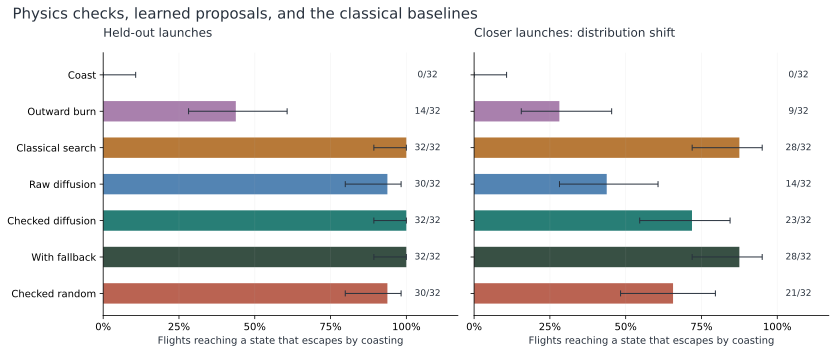
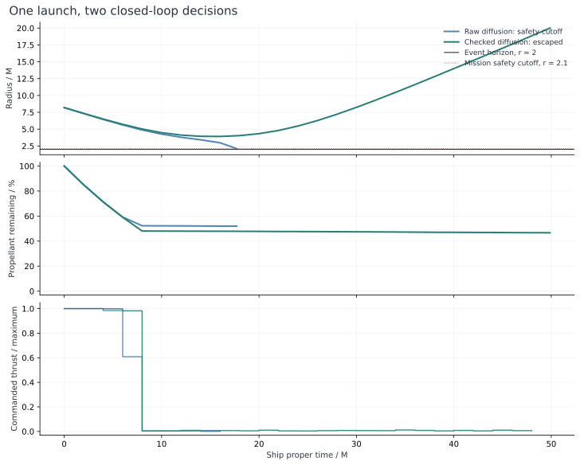

# Can AI escape a black hole?

## A diffusion pilot near the event horizon, judged by relativity

Inside the event horizon, escape is impossible in this Schwarzschild model.
This experiment starts outside it and asks whether a learned pilot can steer away before reaching a safety cutoff.

A small diffusion transformer learned to propose rocket burns from classical demonstrations.
On 64 held-out launches, its first proposal escaped in 44 cases.
Ranking 16 proposals with relativistic equations increased that count to 55, rescuing 11 flights without losing a successful raw flight.
Classical search escaped in 60 cases.
A later control using 29 fixed burn plans also escaped in 60 cases, without learned weights.
The learned controller improved with numerical checking, but these results do not establish that this task needs learning.

[Enter the powered cockpit](/pilot) to replay the same launch under both learned controllers or calculate a new flight.
The experiment combines an action autoencoder, conditional diffusion, a small transformer, and feedback control in a powered Schwarzschild simulator.
Three model fits ran on temporary AWS compute for an estimated infrastructure cost of about two cents.
All temporary resources were deleted and checked.



*Each panel contains 32 frozen launches.
The closer-launch panel tests a radius range excluded from training.
Intervals describe sample uncertainty under binomial assumptions; they are not guarantees for arbitrary flight conditions.*

## From an unpowered predictor to a powered controller

The first black-hole experiment asked whether a learned gravitational potential could predict escape correctly.
Its small neural models could conserve their own energy while giving the wrong escape decision.
An exact Schwarzschild calculation exposed those errors on fixed-energy, fixed-angular-momentum trajectories.
That experiment remains separate from the powered pilot described here.
The earlier rational certificate does not certify thrust commands, arbitrary generated paths, or the new numerical engine.

The experiment asks a specific control question:
**Can a learned proposal distribution improve short burn-plan selection on a fixed, fuel-limited Schwarzschild benchmark?**
The model proposes controls, the physical simulator scores them, and the controller executes one command before observing the next state.
The model does not predict flight dynamics.
The contribution is the measured comparison between these controller arrangements.
The experiment introduces no new learning algorithm or physical law.

## A powered flight model with explicit limits

The ship follows an equatorial timelike trajectory around a nonrotating black hole.
The engine uses geometric units, `G=c=M=1`, and the ship's proper time.
The state is radius `r`, radial four-velocity component `u=dr/dτ`, angular momentum `L`, angle `φ`, and consumed proper impulse `q`.
With `f=1−2/r`, its instantaneous energy is

```
E = sqrt(u² + f(1 + L²/r²)).
```

Energy and angular momentum change during thrust.
They are constants only during the unpowered part of a trajectory.

Each command has two components, radial and tangential, constrained to the unit disk.
The engine scales this command to a maximum proper acceleration of `0.035` in the chosen geometric units.
It constructs the four-acceleration in instantaneous rest axes obtained from the static observer's axes by a rotationless boost.
This construction satisfies `U·A=0` and gives the commanded proper acceleration magnitude.
The axes are defined anew at each state; the model does not evolve spacecraft attitude.
The covariant force construction and ideal rocket mass law follow [Henriques and Natário's rocket formulation](https://arxiv.org/abs/1105.5235).
The background metric and connection follow [Carroll's general relativity notes](https://arxiv.org/abs/gr-qc/9712019).
The reduced equations and implementation checks are recorded in [the powered physics report](pilot-physics-report.md).

The equations use `h=√f`, `p=L/r`, and `S=u*a_r+h*p*a_φ`, where `a_r` and `a_φ` are the scaled proper accelerations.
The stable reduced system is

```
dr/dτ = u
du/dτ = −1/r² + L²/r³ − 3L²/r⁴ + h*a_r + u*S/(E+h)
dL/dτ = r*a_φ + L*S/(E+h)
dφ/dτ = L/r²
dq/dτ = sqrt(a_r² + a_φ²)
dE/dτ = S
```

The implementation derives `E` from the state rather than integrating an additional energy variable.
The work identity `dE/dτ=S` supplies a separate check on that derivative.
Setting both controls to zero recovers the unpowered equations and preserves energy and angular momentum.
The `E+h` denominators avoid an unnecessary subtraction in the boosted force terms.

The proper-impulse budget is `q=0.7`.
An ideal constant exhaust speed of `0.7c` gives the mass law `m/m₀=exp(−q/0.7)`.
This is extreme idealized propulsion, not a human spacecraft engineering model.
The black-hole mass is unspecified, so absolute acceleration and elapsed seconds depend on the chosen mass scale.

The numerical mission ends at the safety surface `r=2.1` or at the escape surface `r=20`.
Escape also requires outward motion and `E≥1+10⁻⁶`, followed by an intended unpowered continuation.
A safety cutoff does not prove horizon capture or that every possible future maneuver must fail.
An escape label does not certify the result of arbitrary later thrust.
Flights still unresolved at the mission deadline remain unresolved.

## Learning a distribution of burn plans

A classical planner generates the training targets using the powered engine.
Each target contains 12 two-component commands, with each command held for two units of proper time.
The 24 control values are the object being compressed and generated.
The six conditioning values describe radius, radial motion, angular momentum, consumed impulse, instantaneous energy, and inverse radius.
Angle is omitted because Schwarzschild dynamics are axially symmetric.

| Component | Implemented role | Small-model configuration |
| --- | --- | --- |
| Autoencoder | Compress and reconstruct a burn plan | 24 controls, 64-unit hidden layers, 8 latent values |
| Transformer | Estimate latent noise conditioned on state and diffusion time | Four latent tokens, width 32, two blocks, two attention heads |
| Diffusion process | Generate different plausible latent plans | 32 cosine-schedule noise levels |
| Sampler | Convert fresh noise into a latent proposal | 16 deterministic DDIM denoising steps |
| Decoder | Return bounded radial and tangential commands | Unit-disk projection of each command |

These components have distinct jobs.
The autoencoder reduces the plan representation; it does not discover a new physical state space.
The transformer models relationships between latent plan components; it is not a learned time-step simulator.
Diffusion supplies alternative proposals so physical scoring can choose between them.

[Diffuser](https://arxiv.org/abs/2205.09991) motivates generation as a planning mechanism.
[Latent diffusion](https://arxiv.org/abs/2112.10752) motivates denoising in a compressed representation.
[Diffusion Transformers](https://arxiv.org/abs/2212.09748) motivate a transformer denoiser, and [DDIM](https://arxiv.org/abs/2010.02502) supplies the sampling construction.
Those papers do not establish performance on this black-hole task.
This implementation uses a small control representation and state conditioning, rather than reproducing their image or trajectory benchmarks.

The completed teacher dataset contains 2,794 decisions from 80 successful flights.
Of these, 2,248 decisions belong to training and 546 to validation.
Only 94 training decisions and 28 validation decisions begin with an active burn above the specified command-norm threshold of `0.05`.
The combined active-burn fraction is about 4.37%.
The training sampler balances active-burn and coast examples, while validation retains its natural distribution.
This choice aims to prevent a low average reconstruction loss from hiding failure on rare active burns.
All three saved model files confirm that balanced training was applied.

## Measured training and export checks

The fits used seeds 1729, 1730, and 1731 on CPU PyTorch 2.13.0.
Python 3.12.3, NumPy 1.26.4, two Torch threads, and deterministic Torch algorithms were recorded with the weights.
Validation selected the autoencoder and diffusion checkpoints independently.
The diffusion update count refers to optimizer updates; its noise schedule still has 32 levels.

| Fit seed | Selected AE epoch | Selected diffusion update | AE validation MSE | Diffusion noise MSE | Decoder parity error | Denoiser parity error |
| --- | --- | --- | --- | --- | --- | --- |
| 1729 | 66 | 3,100 | `7.65×10⁻⁵` | `0.02273` | `1.24×10⁻⁷` | `3.33×10⁻⁶` |
| 1730 | 78 | 3,600 | `7.29×10⁻⁵` | `0.01352` | `1.57×10⁻⁷` | `2.77×10⁻⁶` |
| 1731 | 116 | 3,800 | `7.22×10⁻⁵` | `0.01136` | `1.23×10⁻⁷` | `2.47×10⁻⁶` |

MSE means mean squared error over the specified validation outputs.
Decoder and denoiser parity errors are maximum absolute differences between PyTorch and the exported NumPy implementations on fixed fixtures.
All six parity errors were below the specified `10⁻⁵` tolerance.
All fits generated finite unit-disk commands and preserved the first proposal when the requested candidate count changed.

The overall autoencoder error hides a large difference between active burns and coasts.
For seed 1729, active-burn reconstruction MSE was `0.001489`, compared with `1.46×10⁻⁷` on coast examples.
The diffusion noise MSE was `0.2941` on active burns and `0.00806` on coasts.
Balanced sampling therefore did not remove the harder active-burn prediction problem.
These losses and implementation checks do not establish successful flight control.
The saved [model metadata](../results/pilot/model/model.json) and [parity report](../results/pilot/model/parity.json) contain the exact values.

## Feedback, selection, and comparison

At each decision, the pilot generates candidate plans, executes only the first command, observes the resulting state, and plans again.
Candidate scoring uses batched RK4 integration through the burn horizon and a subsequent coast.
Executed flight uses the separate DOP853 integration path.
The score rewards escape, penalizes impulse expenditure and safety cutoffs, and assigns progress scores to unresolved plans.
These scoring choices are part of the benchmark specification, not universal definitions of safe control.

| Controller | What it executes | Purpose |
| --- | --- | --- |
| Coast | Zero thrust | Unpowered reference |
| Radial | Fixed outward control | Simple powered reference |
| Raw learned | First of 16 generated plans | Isolate proposal quality without physical ranking |
| Checked learned | Best physical score among 16 generated plans | Measure the effect of numerical ranking |
| Hybrid | Best among 16 learned plans and 29 fixed plans | Test a simple classical fallback library |
| Random checked | Best among 16 smooth random plans | Candidate-count-matched comparison for checked learned |
| Classical teacher | Repeated search with a larger candidate population | Stronger reference that generated the demonstrations |

The checked controller ranks plans; it does not strictly reject every unsafe proposal.
If all 16 proposals fail in the numerical rollout, it can choose the least bad one.
The hybrid controller can also fail when every available plan fails.
Neither arrangement is a formal safety guard.

Random checked and checked learned each score 16 candidates.
The hybrid scores 45 candidates, while the teacher performs a larger, repeated search.
Comparing their success rates without latency and candidate counts would hide this difference in computation.
The experiment therefore records decisions, rollout costs, elapsed time, outcomes, and impulse use together.

Two additional controls were introduced after inspecting the first three nominal test missions.
Those early runs showed that the original random controller consumed its full fuel budget.
The added `random_with_coast` control scores 15 random plans and one explicit coast plan, for 16 candidates total.
The added `fixed_checked` control scores only the existing 29 fixed plans.
These controls test whether missing coast support and a simple fixed library explain an apparent learned advantage.
They are post hoc diagnostics, not part of the original seven-controller experiment.
The original controllers, models, dataset, and result files remain preserved, and no model was tuned from these observations.

## Checks before training

An independent reference constructs Christoffel symbols from metric derivatives and integrates the full coordinate equations.
It does not call the reduced engine's derivative.
Exterior burns agreed to a maximum state error of `9.38×10⁻¹³`; a safety-ending burn agreed to `3.22×10⁻¹¹`.
These are errors on tested trajectories, not bounds over every control sequence.

A broader refinement check examined 464 candidate plans at four and eight RK4 substeps.
It found no outcome disagreements between those resolutions.
Another 65 comparisons used DOP853 references and included 12 escapes, 44 safety cutoffs, and nine unresolved trajectories.
The worst state discrepancy near a cutoff fell from about `0.00123` to `9.78×10⁻⁵` under refinement.
Maximum score discrepancy fell from about `5.94×10⁻⁷` to `3.71×10⁻⁸`.
The saved evidence is [physics-validation.json](../results/pilot/physics-validation.json).
Agreement on these cases does not establish that rankings remain stable arbitrarily close to a decision boundary.

The earlier AWS GYOTO run supplied a separate engine check for 24 unpowered trajectories at two tolerances.
All 24 outcomes agreed with the independent Schwarzschild calculation and local numerical integration.
That result checks the unpowered sector; GYOTO did not validate the new powered thrust implementation.
The details and conservation errors remain in [the GYOTO report](gyoto-adapter.md).

## A fixed experiment and saved checkpoints

The initial benchmark fixes 64 training launches, 16 validation launches, 32 nominal test launches, and 32 stress launches.
Training and validation contain classical teacher decisions from their respective launches.
Test and stress launches are excluded from training.
Train-derived normalization and validation-selected checkpoints are exported with the model.

The main model uses fit seed 1729 and receives the full seven-controller, 64-mission comparison: 448 flights.
Two additional fits, seeds 1730 and 1731, provide a bounded sensitivity check.
Their raw and checked controllers use the first eight nominal and first eight stress missions fixed before evaluation.
This small secondary check does not estimate performance across all training seeds.
Mission uncertainty and training-seed uncertainty must remain separate in the report.

The main benchmark fixes the physics equations, source files, weights, missions, and controller settings before its full evaluation.
The later controls have their own source seal and explicit post hoc declaration.
Their results must remain distinguishable from the original 448 flights.
Local evaluation uses an Apple M2 with eight logical CPUs, two worker processes, and one BLAS thread per worker.
The computer is shared with other work, so its timings are not an isolated hardware performance benchmark.

Source hashes, dataset hashes, model hashes, mission definitions, and controller settings seal each evaluation.
Per-flight files let interrupted evaluation resume without silently accepting a changed experiment.
The exported NumPy decoder and denoiser matched PyTorch fixtures before held-out inference used those weights.
First-proposal parity also checks that requesting more candidates does not change the raw controller's first proposal.

These checkpoints make a long-running experiment inspectable.
They do not turn empirical results into a Lean proof.
The exact unpowered checker, powered numerical reference, training validation, and held-out evaluation answer different questions.

## What happened in 448 flights

The main comparison uses the same 32 nominal and 32 closer launches for every controller.
Nominal launch radius is uniform on `[8,12]`; closer launch radius is uniform on `[6,8]`.
Both use energy in `[0.995,1.04]` and angular momentum in `[2.8,4.2]`.
The closer set changes launch radius, rather than changing the physical equations.

| Controller | Nominal escapes | Closer escapes | Nominal fuel used | Closer fuel used | Nominal / closer decision time |
| --- | --- | --- | --- | --- | --- |
| Coast | 0/32 | 0/32 | 0.0% | 0.0% | <0.1 / <0.1 ms |
| Full outward burn | 14/32 | 9/32 | 100.0% | 95.7% | <0.1 / <0.1 ms |
| Raw diffusion | 30/32 | 14/32 | 32.7% | 33.7% | 9.0 / 9.8 ms |
| Checked diffusion | 32/32 | 23/32 | 25.1% | 35.4% | 35.5 / 34.2 ms |
| Learned plus fixed fallback | 32/32 | 28/32 | 23.7% | 37.0% | 105.7 / 97.0 ms |
| Checked random | 30/32 | 21/32 | 97.2% | 82.1% | 57.2 / 57.7 ms |
| Classical teacher | 32/32 | 28/32 | 24.4% | 31.2% | 337.3 / 310.2 ms |

Fuel is mean propellant consumed across all launches, including failed flights.
A controller that crashes early can use little fuel; read these columns together with success counts.
Decision time covers planning, including candidate integration where used, but excludes the executed DOP853 flight step and rendering.
These are observations on the shared Mac, with two evaluation workers and one BLAS thread each.
Raw diffusion still generates 16 plans and takes the first, so its implementation is not optimized for minimum one-proposal latency.

Checking rescued two nominal flights and nine closer flights relative to raw diffusion.
It lost none of the raw controller's successful flights on this sample.
Nine closer launches still reached the safety cutoff with checking.
The fallback library recovered five additional closer launches, reaching the same escape count as classical search.
Matching escape counts does not establish equal fuel efficiency or optimality.

The 32/32 nominal checked result has a 95% Wilson interval of about 89.3% to 100%.
For closer launches, checked diffusion reached 71.9%, with an interval of about 54.6% to 84.4%.
The raw controller reached 43.8%, with an interval of about 28.2% to 60.7%.
The paired rescue counts carry information that separate intervals omit, because every controller receives the same launch.
These small fixed samples cannot establish a general mission-risk estimate.

All learned, checked, hybrid, classical, and random failures reached the safety cutoff.
Coasting also left two nominal flights unresolved at the deadline.
The outward-burn controller left eight nominal and 11 closer flights unresolved.
Unresolved flights count as failures to establish the specified return condition, without claiming eventual capture.
The exact counts, intervals, and paired outcomes are in [summary.json](../results/pilot/summary.json).
Per-flight metrics are in [trials.csv](../results/pilot/trials.csv).

## One launch, two decisions

The cockpit selects the first held-out launch where checking changes failure into escape, searching nominal missions before closer missions.
This makes it an explanatory example selected by outcome, not a representative random flight.
The selected launch is nominal mission 8, with initial radius `8.19516M` and inward radial velocity `−0.43020`.
Both controllers receive the same initial state and proposal seed.
Their subsequent states diverge as they execute different burns.

The raw controller reaches `r=2.1` after `17.71M` of proper time, with 52.0% of its propellant still aboard.
The checked controller turns around at a sampled minimum radius of `3.91201M`.
It reaches the outward escape surface at `49.87M`, with 46.7% of propellant remaining.
The checked pilot selects a proposal other than the first on 23 of its 25 decisions.
Those changes include small coast corrections as well as active burns; the count alone does not measure useful intervention.



*Both traces use the same relativistic engine.
The raw flight fails before exhausting its fuel.
Its failure is therefore a control failure under this policy, not evidence that the launch lacked enough propellant for every possible maneuver.*

## Supplemental controls and fit sensitivity

The two post hoc controls add 128 flights on the same 64 missions.
They use the same physical scoring and feedback loop, with no learned weights.

| Post hoc controller | Nominal escapes | Closer escapes | Nominal fuel used | Closer fuel used | Nominal / closer decision time |
| --- | --- | --- | --- | --- | --- |
| 15 random plans plus exact coast | 29/32 | 21/32 | 28.7% | 23.5% | 86.2 / 88.2 ms |
| 29 fixed burn/coast plans | 32/32 | 28/32 | 24.4% | 31.6% | 87.1 / 81.3 ms |

Adding exact coast to random proposals reduced nominal mean fuel use from 97.2% to 28.7%, while escape count changed from 30 to 29.
On closer launches, the count stayed at 21 and mean fuel use fell from 82.1% to 23.5%.
The original random baseline therefore exaggerated the learned model's apparent fuel advantage.
Its continuous proposal generator lacked an exact coast action.
The added coast replaces one random plan to retain 16 candidates; it does not preserve all original candidates.
The very low fuel use on some failed coast launches also lowers these averages.
Fuel conditional on successful flight is included in [the supplemental report](pilot-controls-report.md).

The fixed library matched the classical teacher's escape outcome on every tested launch.
It also recovered the same five closer launches that the hybrid recovered relative to checked diffusion.
Adding 16 learned candidates to that fixed library produced no extra escapes.
It reduced nominal mean fuel use slightly, from 24.4% to 23.7%, but increased closer-launch fuel use from 31.6% to 37.0%.
Its observed decision time also increased.

Checked diffusion used fewer candidates and had lower observed decision latency than the fixed library.
It also had five fewer escapes on the closer set.
Those tradeoffs do not establish that the learned proposals are useless, or that they are necessary.
The fixed library has 29 candidates against the learned controller's 16, and these supplemental comparisons were added after early test inspection.
They do refute an unqualified claim that diffusion produced the best controller in this experiment.
The original seven-controller results remain unchanged in their own artifacts.
The separate evidence is [controls-summary.json](../results/pilot/controls-summary.json).

The predeclared fit check uses the first eight nominal and first eight closer missions for each of three training seeds.
It reuses 32 main-run results and computes 64 additional flights.
Those 32 reused results must not be counted again as independent observations.

| Fit seed | Nominal raw / checked escapes | Closer raw / checked escapes | Closer raw / checked mean fuel |
| --- | --- | --- | --- |
| 1729 | 8/8 / 8/8 | 3/8 / 5/8 | 31.8% / 34.8% |
| 1730 | 8/8 / 8/8 | 3/8 / 5/8 | 36.1% / 35.7% |
| 1731 | 8/8 / 8/8 | 3/8 / 5/8 | 34.8% / 36.5% |

All three fits have the same success counts on this subset, despite different validation losses and fuel use.
Checking rescues two closer launches per fit, with no reverse loss.
The subset is too small to establish broad stability across training seeds.
It does show that the main pattern is not confined to one fit on these selected launches.
The complete paired rows are in [seed-check.json](../results/pilot/seed-check.json).

## What this experiment establishes

The controlled comparison separates proposal generation from numerical selection.
The same learned generator performs better when its candidate plans are evaluated before execution.
That arrangement remains fallible because a scorer can only choose from the plans it receives and the horizon it evaluates.
It does not guarantee a feasible escape plan exists in the candidate set.

The simple controls are the main restraint on the AI claim.
A compact fixed library reaches the best observed success count without training.
This small, smooth, two-control problem gives that library a strong advantage.
The result should not be extrapolated to visually observed flight, unknown dynamics, high-dimensional controls, or rotating black holes.
It provides a concrete test case for studying when learned proposals add value to classical search.

Low validation loss also misses a decisive part of the problem.
Most teacher decisions are coasts, while a few early burns determine whether the ship returns.
Separate active-burn losses reveal this imbalance, and closed-loop evaluation exposes errors that average loss does not describe.
The experiment does not isolate whether compression, denoising, or the limited demonstrations caused each failed burn.
That would require additional component ablations on fresh evaluation missions.

The earlier unpowered study tests learned world models; this powered study tests a learned action generator.
Their common design principle is to keep physical judgment outside the learned component when the governing equations are available.
Here that judgment uses numerical integration, while the unpowered turning-point calculation has an exact rational checker.
Neither the neural weights nor the rendered cockpit supplies a physical proof.

## A temporary AWS training job

Training used one temporary `c7i.xlarge` CPU EC2 instance.
The server used Ubuntu 24.04, CPU-only PyTorch, and project-generated data without pretrained weights.
The Mac received the project's own model artifacts and scientific JSON; PyTorch remained on the server.

CloudFormation creates the instance, encrypted root volume, temporary role, security group, and private artifact bucket together.
The instance has no inbound ports and uses SSM for command execution.
Its role can read the source prefix and write the artifact prefix in that bucket.
Artifacts have explicit size limits and SHA-256 verification.
Raw account metadata and command logs remain outside the public results directory.

Installation has a 20-minute timeout, and all three model fits share a 75-minute training allowance.
An operating-system backstop terminates the instance within 120 minutes of startup.
The local runner downloads verified artifacts, terminates compute, empties the bucket, deletes the stack, and checks resource deletion.
Failures still enter the cleanup path.
These measures reduce orphan risk; the final deletion checks supply evidence of what actually happened.

The remote sequence took 73.87 seconds for all three fits, export checks, and artifact assembly.
The full local runner took 381.39 seconds through provisioning, installation, transport, and cleanup.
Its verified compressed return archive contained 17 files and 323,378 bytes.
The elapsed-time estimate for compute, IPv4, and the 20 GiB root disk was `$0.01967`.
That estimate excludes S3, data transfer, and taxes; it is not a measured AWS bill.
The working allowance was `$5` within the approved credit budget.
CloudFormation deletion completed, and subsequent checks confirmed termination of the instance and deletion of its captured root volume.
The private bucket, role, instance profile, and security group were also absent.
No attached root volume remained.
The sanitized evidence is [cloud-run.json](../results/pilot/model/cloud-run.json).
Verified pricing sources and the installation manifest are in [the cloud plan](pilot-cloud-plan.md).

## Reproduce the saved experiment

The returned models run with NumPy, without a local PyTorch installation.
Start the local server and open the powered cockpit:

```sh
OPENBLAS_NUM_THREADS=1 OMP_NUM_THREADS=1 python3 serve.py --port 8008
```

The benchmark scripts preserve completed per-flight checkpoints and reject changed inputs.
Run the evaluations in sequence to keep the two-worker budget:

```sh
python3 -m unittest discover -v
OPENBLAS_NUM_THREADS=1 OMP_NUM_THREADS=1 python3 run_pilot_experiment.py
OPENBLAS_NUM_THREADS=1 OMP_NUM_THREADS=1 python3 run_pilot_controls.py
OPENBLAS_NUM_THREADS=1 OMP_NUM_THREADS=1 python3 run_pilot_seed_check.py
python3 plot_pilot_results.py
python3 build_article.py --pilot
```

With existing checkpoints, these commands rebuild summaries rather than repeat each flight.
The cockpit's custom launch form runs a new trajectory through the same feedback controller.
Preserve the original result directory before starting a changed experiment.
The full record contains 448 main flights, 128 supplemental flights, and 64 additional fit-check flights: 640 distinct evaluation runs.
The 80 teacher flights are separate.

One agent-generated physics error was caught before teacher generation: a missing radius factor in the centrifugal term broke coast-energy conservation.
The correction was checked against the full coordinate reference before the frozen dataset was built.
Source seals, per-flight checkpoints, independent numerical checks, and the cloud termination backstop address different failure modes of autonomous work.
They made this run recoverable and inspectable; they did not remove the need to test it.

## What the cockpit shows

The powered cockpit is a three-dimensional cabin connected to the numerical flight state.
You can look around and move between the seats, consoles, and windshield while the saved flight plays.
Instrument screens show the current radius, fuel, and burn command.
The field screen plots recorded radius against proper time, and the control screen identifies the selected pilot.
This plot is a replay of the computed flight, not a forecast from the learned model.
Time is shown in geometric units, with G=c=M=1, rather than seconds.
The cabin uses local Three.js modules, procedural geometry, metal materials, shadows, and sparse illuminated dust.
No spacecraft model or texture pack was downloaded.
Select Walk cabin and use WASD to walk at standing height, with collision against cabin furniture.
Camera movement changes your view inside the cabin; the numerical controller determines the ship's trajectory.

The exterior traces Schwarzschild light paths, with an approximate camera frame and artistic disk emission.
Fine sheared bands supply the disk texture; this is not a fluid simulation.
An artistic camera tilt brings the upper lensed arc into view at launch.
It does not calculate the full optical view of an accelerating observer.
The cabin is a cinematic visualization, not a validated spacecraft design or a claim of film-quality photorealism.
The experiment omits black-hole spin, orbital inclination, self-gravity, radiation forces, and vehicle attitude dynamics.
Its visual trace helps inspect control decisions, but the saved numerical outcomes determine the research result.
